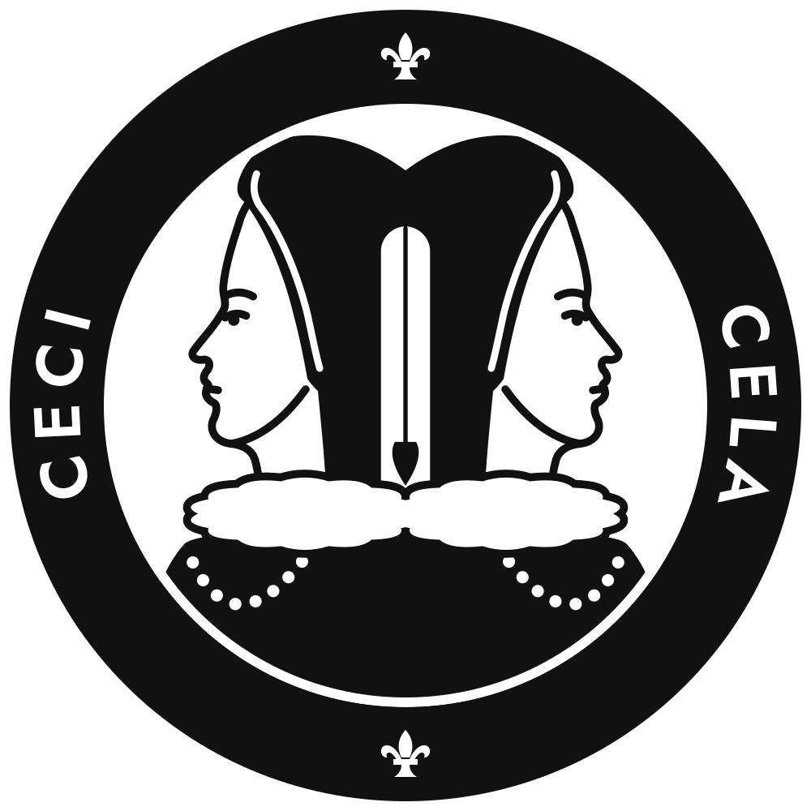
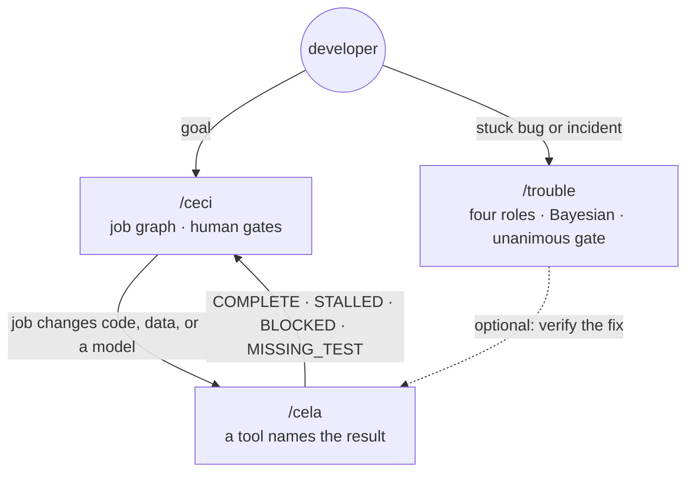

<p align="center"></p>

# ceciCela

[](https://github.com/actviteai/cecicela/actions/workflows/ci.yml)
[](https://www.npmjs.com/package/@actvite/cecicela)
[](LICENSE)

> ceci plans this, cela proves that, trouble fixes what breaks.

**ceciCela** is three agent skills for coding agents, shipped as one product:

| Skill | What it does | Package |
| --- | --- | --- |
| [`/ceci`](packages/ceci) | Turns a goal into a job graph, runs ready jobs in dependency order, stops at human gates before contact, posting, payment, or pricing, places GPU jobs, and hands every code, data, or model change to `/cela`. | `@actvite/ceci` |
| [`/cela`](packages/cela) | The evidence gate. A bundled tool runs the checks, scores the oracles, and names the result (`COMPLETE`, `STALLED`, `BLOCKED`, `MISSING_TEST`), so the model never grades its own work. | `@actvite/cela` |
| [`/trouble`](packages/trouble) | A four-roles debug protocol for stuck bugs and incidents: verbatim evidence, Bayesian ranking, and no fix until the roles unanimously agree. Ends with a machine-parseable verdict. | `@actvite/trouble` |

`/cecicela` is a thin front door that says which of the three fits and hands off.



Zero third-party dependencies. Node.js 22+. GPL-3.0-or-later.

## <a id="install"></a> Install

```bash
npx --yes @actvite/cecicela install --all      # all three, into every harness
npm install -g @actvite/cecicela               # or keep the CLI: cecicela install | status | update
```

`install` writes each skill into the nine coding-agent harnesses ceciCela supports: Claude Code, Grok, Codex, Cline, Goose, Cursor, GitHub Copilot, Google Antigravity, and Hermes Agent. Name harnesses to install only those (`--claude --codex`), or skills (`--only trouble`). Restart the agent session, then type `/ceci`, `/cela`, or `/trouble`. Each skill also installs on its own: `npx --yes @actvite/trouble install --all`.

| Command | Does |
| --- | --- |
| `cecicela install [--all\|--<harness>] [--only ceci,cela,trouble] [--force]` | Installs the skills and the front door; `--force` replaces harness files you edited (yours is kept as a backup) |
| `cecicela status` | Which skill is installed in which harness |
| `cecicela update` | Reinstalls into every harness that already has any of them; `npx --yes @actvite/cecicela@latest update` moves to a newer release |

### Plugin marketplaces

This repository is a marketplace. It lists the bundle (`cecicela`) and each skill on its own.

```bash
claude plugin marketplace add actviteai/cecicela     # or /plugin marketplace add actviteai/cecicela in a session
claude plugin install cecicela@cecicela               # or ceci@cecicela, cela@cecicela, trouble@cecicela

grok plugin marketplace add actviteai/cecicela
grok plugin install cecicela --trust

copilot plugin marketplace add actviteai/cecicela
copilot plugin install cecicela@cecicela

codex plugin marketplace add actviteai/cecicela
```

**What people type.** Claude Code namespaces a plugin's skills by the plugin name: from the bundle the full commands are `/cecicela:ceci`, `/cecicela:cela`, and `/cecicela:trouble`. The short `/ceci` works when no other installed skill claims the name. Every other host takes the skill name as it is.

**Hermes Agent:** `hermes skills install https://raw.githubusercontent.com/actviteai/cecicela/main/bundle/hermes/ceci/SKILL.md` (and `cela`), or the hub path `actviteai/cecicela/bundle/hermes/trouble`.

**GitHub Copilot** has no central plugin directory. `cecicela install --copilot` writes the skills to `~/.copilot/skills/` and a `cecicela` custom agent to `~/.copilot/agents/`, so the three show in the agent picker.

## In a chat: ceciCela for Projects

The chat versions are the free entry point. A Project pack puts a router in the Project's instructions and the protocols in its knowledge; it ships for four hosts from [`chat/`](chat):

| Host | What is published | Setup |
| --- | --- | --- |
| ChatGPT | the ceciCela GPT in the GPT Store, or a Project you build yourself | [chat/chatgpt/SETUP.md](chat/chatgpt/SETUP.md) |
| Claude | a setup kit for a Claude Project, and the graph player as a public artifact | [chat/claude/SETUP.md](chat/claude/SETUP.md) |
| Grok | a setup kit for a Grok Project (and a shared Project where Grok allows it) | [chat/grok/SETUP.md](chat/grok/SETUP.md) |
| Microsoft 365 Copilot | a declarative agent for the Commercial Marketplace (Agents Toolkit project) | [chat/m365/SETUP.md](chat/m365/SETUP.md) |

In chat, trouble leads: it runs its `untooled` mode (no files, no commands, confidence capped at 6, the incident stays open until you run the check). ceci becomes a planner that hands `brief.md` and `state.md` back as files. cela becomes a review checklist that says plainly no tool ran and there is no gate. Each states its limits in its first reply, and each ends with the install line for the full product.

## The graph view

`ceci status --watch` draws the job graph as an 80x24 pure-ASCII screen, BBS-door style, and redraws it as `state.md` changes; `--screen` prints it once. The chat packs draw the same screen with an HTML player that runs the same renderer ([`packages/core/lib/tui.js`](packages/core/lib/tui.js)), and a test asserts both print identical screens.

```text
 ceciCela  TUI | ceci: ship the docs site                  turn 11/11  graph:on
  +==============+    +==============+    +==============+    +--------------+
  |j1 scaffold re|-+->|j2 content mod|--->|j4 build pages|*+->|j5 deploy     |
  | done  cela OK| |  | done  cela OK|    | done  cela OK| |  | | run  cela..|
  +==============+ |  +==============+    +==============+ |  +--------------+
                   |                                       |
                   |  +==============+                     |
                   +->|j3 pick theme |-----------o*--------+
                   |  | done         |
                   |  +==============+
                   |
                   |  +--------------+
                   +->|j6 announce   |
                      | pending      |
                      +--------------+
```

The model never draws frames. It emits one event line per state change (`j4 done cela:ok`); the player computes every moving part, packets, spinner, blink, and typing, from those lines. The whole demo run is 11 events and 207 bytes of model output. In chat, the player is emitted once per conversation and edited after that, one line per turn.

## Repository layout

```text
packages/
  core/        (private) harness table, installer, generated-copy sync, version stamps, the TUI renderer
  ceci/        @actvite/ceci       skill/ (SKILL.md, playbooks, tool/ceci.js), bin/, lib/
  cela/        @actvite/cela       skill/ (SKILL.md, playbooks, tool/cela.js), bin/, lib/, bridges/, eval/, nemo/
  trouble/     @actvite/trouble    skill/ (SKILL.md, voices.default.yaml, tool/voices.js), bin/, lib/
  cecicela/    @actvite/cecicela   the bundle CLI, the /cecicela front door, the Copilot agent
bundle/        generated: one plugin per package for Claude Code, Codex, Grok, and Copilot; Hermes copies
chat/          src/ (written by hand) -> pack/ and claude/, chatgpt/, grok/, m365/ (generated)
.claude-plugin/ .github/plugin/ .grok-plugin/ .agents/plugins/   generated marketplace catalogs
scripts/       sync, test, stamp, release
test/          repository tests: the bundle, the chat tier, the acceptance criteria
docs/archive/  the notices that replace the old repositories' READMEs
brand/         the seal (SVG masters, PNG exports, the banner source) and its provenance
```

`packages/core` is never published: `npm run sync` copies it into each package's `lib/core/`, so every npm tarball is self-contained. Everything generated is committed, and `npm test` fails when any of it drifts from its source.

## Development

```bash
npm ci                 # links the workspaces; there are no third-party dependencies
npm test               # sync --check, core and repository tests, then every package's suite
npm run sync           # re-render every generated file after changing a source
npm run chat:build     # just the chat tier
npm run stamp          # write package versions into every place that repeats them
```

CI runs `npm test` on Linux, macOS, and Windows with Node 22 and 24, Claude Code's plugin validator on the marketplace, and, as a separate optional job, the NeMo pytest suite (the one Python package, `packages/cela/nemo`).

### Releasing

Each package keeps its own semver; the bundle's version moves whenever a skill's does, and its manifest records which skill versions it contains.

```bash
npm run release -- --bump trouble=patch     # bump, stamp, sync, test, stage
```

`npm run release` never publishes. It stamps and syncs, runs `npm test`, stages each package as a tarball in `dist/tarballs/`, makes a `0.0.0-stage` placeholder for any name npm has never seen, and writes `dist/release-plan.md`: what npm already has, the tarball contents, and the publish commands in dependency order (cela, trouble, ceci, then cecicela). A maintainer publishes from those tarballs with npm two-factor authentication. CI holds no npm token. A tag such as `trouble@1.0.1` triggers a workflow that only verifies the tag matches `npm test` and the package version.

## Where it came from

ceciCela supersedes three repositories, archived once these packages are live: [actviteai/ceci](https://github.com/actviteai/ceci) (ceci 1.x), [actviteai/rdapq](https://github.com/actviteai/rdapq) (the RDAP-Q engine, now cela; `@actvite/rdapq` 2.1.0 was its last release under that name), and [actviteai/trouble](https://github.com/actviteai/trouble). cela 1.0.0 is that engine renamed: its oracles, `state.jsonl` format, and memory records are unchanged. trouble's four voices are now generic roles you can rename. The notices are in [`docs/archive/`](docs/archive). <!-- keep-version -->

## Security, conduct, license

Report vulnerabilities privately; see [SECURITY.md](SECURITY.md). Code of conduct: be chill, be cool, treat others as you would want to be treated; see [CODE_OF_CONDUCT.md](CODE_OF_CONDUCT.md).

ceciCela is free software: you can redistribute it and modify it under the terms of the [GNU General Public License v3.0](LICENSE), or (at your option) any later version (`GPL-3.0-or-later`).
