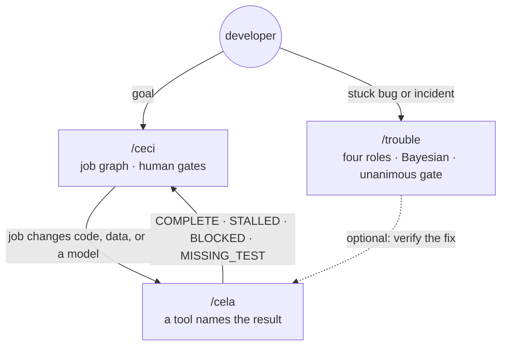

<p align="center"></p>

# ceciCela

[](https://github.com/actviteai/cecicela/actions/workflows/ci.yml)
[](https://www.npmjs.com/package/@actvite/cecicela)
[](LICENSE)

> ceci plans this, cela proves that, trouble fixes what breaks.

▶ **Video:** [ceciCela, explained](https://youtu.be/i5Ge36L_MTk) on the [actVite YouTube channel](https://www.youtube.com/channel/UCPlRHTUre-GPCK__77zI5IQ).

**ceciCela** is three agent skills for coding agents, shipped as one product:

| Skill | What it does | Package (latest on npm) |
| --- | --- | --- |
| [`/ceci`](packages/ceci) | Turns a goal into a job graph, runs ready jobs in dependency order, stops at human gates before contact, posting, payment, or pricing, places GPU jobs, and hands every code, data, or model change to `/cela`. | [](https://www.npmjs.com/package/@actvite/ceci) |
| [`/cela`](packages/cela) | The evidence gate. A bundled tool runs the checks, scores the oracles, and names the result (`COMPLETE`, `STALLED`, `BLOCKED`, `MISSING_TEST`), so the model never grades its own work. | [](https://www.npmjs.com/package/@actvite/cela) |
| [`/trouble`](packages/trouble) | A four-roles debug protocol for stuck bugs and incidents: verbatim evidence, Bayesian ranking, and no fix until the roles unanimously agree. Ends with a machine-parseable verdict. | [](https://www.npmjs.com/package/@actvite/trouble) |

`/cecicela` is the front door. On its own it offers four choices: start something new, review what the work directory and your agent's memory already hold, see every command, or improve your prompt before it runs. Given a task, it names the skill that fits and hands off. After each result, every skill asks once how it landed: good, adjust, retry another way, or report a problem (see [Feedback](#feedback)).



Zero third-party dependencies. Node.js 22+. GPL-3.0-or-later.

**In short:** ceciCela is an open-source set of **AI agent skills** (`SKILL.md` skills in the Agent Skills format) for **AI coding agents** and **LLM agents**: Claude Code skills, Codex skills, Cursor skills, GitHub Copilot skills, and more. It adds **agentic workflow planning** (a task graph, or DAG, with **human-in-the-loop** approval gates), **verification and evaluation** of every agent change (an evidence gate run by a tool, not an **LLM-as-judge**), and **root-cause analysis** for stuck bugs. It is built for **machine learning** and **MLOps** work as much as for application code: **GPU job scheduling** with CUDA, **model evaluation** gates, data-leakage and regression checks, and reproducible results. See [Machine learning advantages](#machine-learning-advantages) and [XGBoost with ceciCela](#xgboost-with-cecicela).

## <a id="install"></a> Install

```bash
npx --yes @actvite/cecicela install --all      # all of ceciCela, into every harness
npm install -g @actvite/cecicela               # or keep the CLI: cecicela install | status | update
```

`install` writes each skill into the nine coding-agent harnesses ceciCela supports: Claude Code, Grok, Codex, Cline, Goose, Cursor, GitHub Copilot, Google Antigravity, and Hermes Agent. Name harnesses to install only those (`--claude --codex`). Restart the agent session, then type `/ceci`, `/cela`, or `/trouble`.

**ceciCela installs as one product.** You never get one skill without the others: `npx --yes @actvite/trouble install` (or `@actvite/ceci`, or `@actvite/cela`) hands off to `@actvite/cecicela` and installs all three skills and the front door, the marketplaces list only the `cecicela` plugin, and `cecicela update` completes an older partial install.

| Command | Does |
| --- | --- |
| `cecicela install [--all\|--<harness>] [--force]` | Installs the three skills and the front door; `--force` replaces harness files you edited (yours is kept as a backup) |
| `cecicela status` | Which skill is installed in which harness |
| `cecicela update [--force]` | Reinstalls all of ceciCela into every harness that has any part of it; `npx --yes @actvite/cecicela@latest update` moves to a newer release |
| `cecicela --version` | The bundle version and the exact skill versions it carries |

### Plugin marketplaces

This repository is a marketplace with one plugin, `cecicela`: all three skills and the front door.

```bash
claude plugin marketplace add actviteai/cecicela     # or /plugin marketplace add actviteai/cecicela in a session
claude plugin install cecicela@cecicela

grok plugin marketplace add actviteai/cecicela
grok plugin install cecicela --trust

copilot plugin marketplace add actviteai/cecicela
copilot plugin install cecicela@cecicela

codex plugin marketplace add actviteai/cecicela
```

**What people type.** Claude Code namespaces a plugin's skills by the plugin name: from the bundle the full commands are `/cecicela:ceci`, `/cecicela:cela`, `/cecicela:trouble`, and the front door `/cecicela:cecicela` (a bare `/cecicela` comes from `cecicela install`). The short `/ceci` works when no other installed skill claims the name. Every other host takes the skill name as it is.

**Hermes Agent:** `npx --yes @actvite/cecicela install --hermes` writes all four skills under `~/.hermes/skills/software-development/`.

**GitHub Copilot** has no central plugin directory. `cecicela install --copilot` writes the skills to `~/.copilot/skills/` and a `cecicela` custom agent to `~/.copilot/agents/`, so the three show in the agent picker.

## In a chat: ceciCela for Projects

The chat versions are the free entry point. A Project pack puts a router in the Project's instructions and the protocols in its knowledge; it ships for four hosts from [`chat/`](chat):

| Host | What is published | Setup |
| --- | --- | --- |
| ChatGPT | a setup kit for a ChatGPT Project (custom GPTs retire on 11 December 2026; a public plugin follows when OpenAI opens submission) | [chat/chatgpt/SETUP.md](chat/chatgpt/SETUP.md) |
| Claude | a setup kit for a Claude Project, and the graph player as a public artifact | [chat/claude/SETUP.md](chat/claude/SETUP.md) |
| Grok | a setup kit for a Grok Project (and a shared Project where Grok allows it) | [chat/grok/SETUP.md](chat/grok/SETUP.md) |
| Microsoft 365 Copilot | a declarative agent with custom skills (Agents Toolkit project), for Frontier tenants now and the Commercial Marketplace once Microsoft accepts skills there | [chat/m365/SETUP.md](chat/m365/SETUP.md) |

Type `cecicela` (or `start`) for the start menu, `help` for every command, `optimize <your request>` to tighten a prompt before it runs, and `feedback` to say how the last result landed.

In chat, trouble leads: it runs its `untooled` mode (no files, no commands, confidence capped at 6, the incident stays open until you run the check). ceci becomes a planner that hands `brief.md` and `state.md` back as files. cela becomes a review checklist that says plainly no tool ran and there is no gate. Each states its limits in its first reply, and each ends with the install line for the full product.

## Machine learning advantages

Coding agents write training code quickly. They are much worse at knowing whether a model change actually made the model better. A script that trains without error, a notebook that looks right, or a validation score copied from the agent's own summary are all self-grades, and self-grades are what ceciCela removes. For ML work that matters more than anywhere else, because a leaked feature or a lucky seed produces a number that looks like progress.

- **`/ceci` plans the pipeline.** It writes the whole pipeline as a job graph before anything runs: data split, features, training, evaluation against the baseline, and the report. A job starts only when its dependencies are done. Every job that changes code, data, or a model goes through `/cela`.
- **`/cela` decides when a model change is done.** It accepts a feature, data, or hyperparameter change only when tests the tool runs say so. Each clause of the request ("holdout AUC is not below the baseline", "the encoder is fit on training folds only") is a requirement that must be covered by a named test. The tool runs the tests, records the exit codes and the exact diff it measured, and prints the verdict.
- **The round limit stops endless tuning.** `cela check` refuses a fourth round, and the same failure twice ends as `STALLED`. An agent cannot keep re-tuning until a seed happens to pass, which is the agent's version of overfitting to the validation set.
- **Every experiment leaves a record.** `.cela/rounds/<n>.patch` holds the exact diff each check measured, and `.cela/state.jsonl` holds every command, exit code, and verdict. ceci's `log.md` and `events:` say which job ran when. A model change can be reviewed, and reproduced, from what is on disk.
- **`/trouble` debugs regressions.** When a metric drops and nobody knows why, it lists the possible causes (leakage, a changed split, a new library default, a seed, a data refresh) and ranks them on verbatim evidence. It changes nothing until all four roles agree.
- **Model jobs are placed on GPUs from your own file.** `ceci resolve-gpu` picks a free device from a preference file you write and prints `CUDA_VISIBLE_DEVICES`. ceci never probes the machine.
- **People decide what leaves the building.** ceci stops for a human before anything is posted, sent, paid for, or priced, so a model's results are not published or sold on an agent's say-so.
- **Python ML stacks can call the gate too.** The NVIDIA NeMo Agent Toolkit gets the same gate as Python tools (`cela-nat`, see [cela](packages/cela#nvidia-nemo-agent-toolkit-framework-integration)).

## XGBoost with ceciCela

### Why XGBoost fits

- **A gate can afford to retrain it.** Gradient-boosted trees on tabular data train in seconds to minutes, so a test can retrain and score the model on every `cela check`, and the three-round limit keeps the total cost bounded.
- **Its results repeat.** With `tree_method="hist"`, a fixed `random_state`, and a fixed holdout split, a run is repeatable enough to compare against a stored baseline. On GPU, allow a small tolerance, because `hist` training is not guaranteed to match bit for bit across devices.
- **It reports numbers a test can assert.** AUC, log loss, or RMSE on the holdout, `best_iteration` from early stopping, and feature importance from `get_booster().get_score(importance_type="gain")` are all plain numbers. A leaked feature often shows up as one feature carrying most of the gain, which a test can catch.
- **It shares GPUs cleanly.** `device="cuda"` uses the device in `CUDA_VISIBLE_DEVICES`, which is exactly what `ceci resolve-gpu` prints, so two training jobs do not land on the same GPU.
- **It is the natural model for ceciCela's own data.** `cela export` writes a small tabular dataset, described in step 5 below.

### How to use XGBoost with `/cecicela`

1. **Start from the front door.** Type `/cecicela` and describe the goal, for example "add a merchant feature to the fraud model and prove it does not lower AUC". A multi-step pipeline goes to `/ceci`, a single model change to `/cela`, and a metric that dropped for no clear reason to `/trouble`.
2. **Place the training job.** ceci runs `ceci resolve-gpu --work-dir run --gpu-pref gpus.yaml --model xgb-hist`. It prints the `host:device` to store on the job, plus `CUDA_VISIBLE_DEVICES`, which it exports for that job only.
3. **Write the test that is the gate.** Train on the fixed split, score the holdout, and compare against the baseline stored in the repository. Pick the device from the environment, so the same test runs on a laptop CPU:

   ```python
   # tests/test_model.py
   import json, os, pathlib
   import xgboost as xgb
   from sklearn.metrics import roc_auc_score
   from src.train import load_split, make_features

   BASELINE = json.loads(pathlib.Path("tests/baseline.json").read_text())
   DEVICE = "cuda" if os.environ.get("CUDA_VISIBLE_DEVICES") else "cpu"

   def test_auc_not_below_baseline():
       X_train, X_hold, y_train, y_hold = load_split(seed=0)
       features = make_features().fit(X_train, y_train)
       model = xgb.XGBClassifier(tree_method="hist", device=DEVICE, random_state=0,
                                 n_estimators=400, learning_rate=0.05, max_depth=6)
       model.fit(features.transform(X_train), y_train)
       auc = roc_auc_score(y_hold, model.predict_proba(features.transform(X_hold))[:, 1])
       assert auc >= BASELINE["auc"] - 0.002
   ```

   Add a second test for leakage, for example that the target encoder is fit on training rows only, or that no single feature carries most of the gain.
4. **Let cela decide.**

   ```bash
   cela start --risk MODERATE \
     --task "add a target-encoded merchant feature to the XGBoost fraud model" \
     --req "holdout AUC is not below the stored baseline" \
     --req "the target encoder is fit on training folds only" \
     --files src/features.py,src/train.py,tests/test_model.py,tests/test_leakage.py \
     --run "pytest -q tests"
   cela cover R1 tests/test_model.py "test_auc_not_below_baseline"
   cela cover R2 tests/test_leakage.py "test_encoder_fit_on_train_only"
   cela check
   cela gate        # exit 0 only on COMPLETE
   ```

   The repo oracle fails the check if the agent touched files outside the plan, such as `tests/baseline.json` or the data. For a bug fix, such as a leak, add `--repro "<test that fails now>"` and use `--risk HIGH`. cela then requires that the test failed before the fix and passes after it.
5. **Learn from the record.** `cela export --out tasks.jsonl` writes one anonymized row per task: risk, number of requirements, rounds, the Q score and diff size for each round, the gate's verdict, and the reviewer's later outcome (`accepted`, `revised`, `rejected`). That makes a small labeled tabular dataset, and an XGBoost classifier is a natural first model for predicting which agent changes a reviewer will reject.

## The graph view

`ceci status --watch` draws the job graph as an 80x24 screen, BBS-door style, and redraws it as `state.md` changes; `--screen` prints it once. The chat packs draw the same screen with an HTML player that runs the same renderer ([`packages/core/lib/tui.js`](packages/core/lib/tui.js)), and a test asserts both print identical screens. This is the example plan, as `ceci status --screen` prints it:

```text
 ceciCela | ceci: ship the docs site                              4/6 done  low
  +==============+    +==============+    +==============+    +--------------+
  |j1 scaffold re|-+->|j2 content mod|--->|j4 build pages|*+->|j5 deploy     |
  | done  cela OK| |  | done  cela OK|    | done  cela OK| |  | | run  cela..|
  +==============+ |  +==============+    +==============+ |  +--------------+
                   |                                       |
                   |  +==============+                     |
                   +->|j3 pick theme |-----------o*--------+
                   |  | done         |
                   |  +==============+
                   |
                   |  +--------------+
                   +->|j6 announce   |
                      | pending      |
                      +--------------+

 [###########.....] 4/6 done  1 running
 RUN   j5: deploy
+-- log.md --------------------------------------------------------------------+
| #09     j3 done gate:approved                                                |
| #10     j6 blocked                                                           |
| #11     j5 running cela:pending_                                             |
+------------------------------------------------------------------------------+
 [G]raph [L]egend [B]udget [T]heme [SPC]pause [R]eplay [Q]uit         11 ev 207B
```

Everything on it comes from `state.md`. A long plan wraps into bands of four depths; when it does not fit, the view follows the running or gated job and counts what it hides (`<< 3 earlier`). Row 16 shows the real counts, row 17 the job that needs attention (or, at the higher budgets, the newest step), and the log shows the last three events. Events carry the UTC minute they were recorded, so the bottom row says `as of 05:40Z` (the player adds its age, `05:40Z 12m ago`) and a view nobody updated looks stale instead of current. After each update the agent says `view: 4/6 done, as of 05:40Z`, or `view not updated`.

The model never draws frames. It emits one event line per state change (`j4 done cela:ok`); the renderer computes every moving part, packets, spinner, blink, and typing, from those lines. The whole example run is 11 events and 207 bytes of model output. The drawing is free; the **budget** sets how often the agent spends tokens updating it:

| `budget` | The agent records | The view adds |
| --- | --- | --- |
| `low` (default) | status changes only | nothing |
| `medium` | up to three real milestones per job | a NOW line with the newest step |
| `creator` | every real step, for a live audience | step counts, and effects on real changes only (a flash on the newest event, sparks when a job finishes); the ansi theme |

Every budget is honest: a step is written after the work happened, with numbers copied from the output, and a lower budget shows less, never something made up. Type `budget low|medium|creator` in the conversation to switch. The keys are on the bottom row (clickable in the player): `G` graph, `L` legend, `B` budget (explains the three; in `--watch` it saves your choice), `T` theme (phosphor, amber, or ansi: the 16-colour BBS palette with box-drawing lines), space pause, `R` replay, `Q` quit.

Where it shows is your choice when ceci starts: `terminal` (you run `--watch`; no tokens), `chat` (a page beside the conversation: in Claude Code the agent republishes a file by path, which costs no page tokens; in a chat app it builds the 35 KB player once, about 10,000 tokens, then appends one line per update), or `off`.

## Feedback

After a result (a ceci run handing back, a trouble verdict, a cela review, an improved prompt), the skill asks once: **good**, **adjust** (say what; it changes the same result and shows what changed), **retry** (a different approach, never the same one again), or **report** a problem with ceciCela. For ceci the answer is kept with the plan (`ceci feedback`, the `feedback:` list in `state.md`), and the next run starts from it.

A report becomes a GitHub issue draft that you see first and file yourself, with no file contents or names unless you add them: [open an issue](https://github.com/actviteai/cecicela/issues/new). The skills never file it for you.

## Repository layout

```text
packages/
  core/        (private) harness table, installer, generated-copy sync, version stamps, the TUI renderer
  ceci/        @actvite/ceci       skill/ (SKILL.md, playbooks, tool/ceci.js), bin/, lib/
  cela/        @actvite/cela       skill/ (SKILL.md, playbooks, tool/cela.js), bin/, lib/, bridges/, eval/, nemo/
  trouble/     @actvite/trouble    skill/ (SKILL.md, voices.default.yaml, tool/voices.js), bin/, lib/
  cecicela/    @actvite/cecicela   the bundle CLI, the /cecicela front door, the Copilot agent
bundle/        generated: the cecicela plugin (all four skills) for Claude Code, Codex, Grok, and Copilot
chat/          src/ (written by hand) -> pack/ and claude/, chatgpt/, grok/, m365/ (generated)
.claude-plugin/ .github/plugin/ .grok-plugin/ .agents/plugins/   generated marketplace catalogs
scripts/       sync, test, stamp, release
test/          repository tests: the bundle, the chat tier, the acceptance criteria
docs/archive/  the notices that replace the old repositories' READMEs
brand/         the seal (SVG masters, PNG exports, the banner source) and its provenance
```

`packages/core` is never published: `npm run sync` copies it into each package's `lib/core/`, so every npm tarball is self-contained. Everything generated is committed, and `npm test` fails when any of it drifts from its source.

## Development

```bash
npm ci                 # links the workspaces; there are no third-party dependencies
npm test               # sync --check, core and repository tests, then every package's suite
npm run sync           # re-render every generated file after changing a source
npm run chat:build     # just the chat tier
npm run stamp          # write package versions into every place that repeats them
```

CI runs `npm test` on Linux, macOS, and Windows with Node 22 and 24, Claude Code's plugin validator on the marketplace, and, as a separate optional job, the NeMo pytest suite (the one Python package, `packages/cela/nemo`).

### Releasing

Each package keeps its own semver; the bundle's version moves whenever a skill's does, and its manifest records which skill versions it contains.

```bash
npm run release -- --bump trouble=patch     # bump, stamp, sync, test, stage
```

`npm run release` never publishes. It stamps and syncs, runs `npm test`, stages each package as a tarball in `dist/tarballs/`, makes a `0.0.0-stage` placeholder for any name npm has never seen, and writes `dist/release-plan.md`: what npm already has, the tarball contents, and the publish commands in dependency order (cela, trouble, ceci, then cecicela). A maintainer publishes from those tarballs with npm two-factor authentication. CI holds no npm token. A tag such as `trouble@1.0.1` triggers a workflow that only verifies the tag matches `npm test` and the package version.

The first release, with the retirement of the old packages and repositories, follows [docs/release-runbook.md](docs/release-runbook.md). The chat packs are tested by hand with [docs/testing-chat.md](docs/testing-chat.md).

## Where it came from

ceciCela supersedes three repositories, now archived: [actviteai/ceci](https://github.com/actviteai/ceci) (ceci 1.x), [actviteai/rdapq](https://github.com/actviteai/rdapq) (the RDAP-Q engine, now cela; `@actvite/rdapq` 2.1.0 was its last release under that name, and the package has since been unpublished from npm; the unscoped `rdap-q` stays, deprecated), and [actviteai/trouble](https://github.com/actviteai/trouble). cela 1.0.0 is that engine renamed: its oracles, `state.jsonl` format, and memory records are unchanged. trouble's four voices are now generic roles you can rename. The notices are in [`docs/archive/`](docs/archive). <!-- keep-version -->

## Security, conduct, license

Report vulnerabilities privately; see [SECURITY.md](SECURITY.md). Code of conduct: be chill, be cool, treat others as you would want to be treated; see [CODE_OF_CONDUCT.md](CODE_OF_CONDUCT.md).

ceciCela is free software: you can redistribute it and modify it under the terms of the [GNU General Public License v3.0](LICENSE), or (at your option) any later version (`GPL-3.0-or-later`).

**Keywords:** AI agent skills, agent skills, SKILL.md, Claude Code skills, Claude Code plugin, Codex skills, Cursor skills, GitHub Copilot agent, Grok, Cline, Goose, Google Antigravity, Hermes Agent, AI coding agent, LLM agents, agentic AI, agentic workflows, agent orchestration, task graph, DAG, human-in-the-loop, approval gates, quality gates, evidence gate, AI code verification, AI evaluation, evals, reproducibility, root-cause analysis, debugging, incident response, Bayesian reasoning, machine learning, MLOps, model evaluation, XGBoost, gradient boosting, tabular data, data leakage, GPU scheduling, CUDA, NVIDIA NeMo Agent Toolkit.
