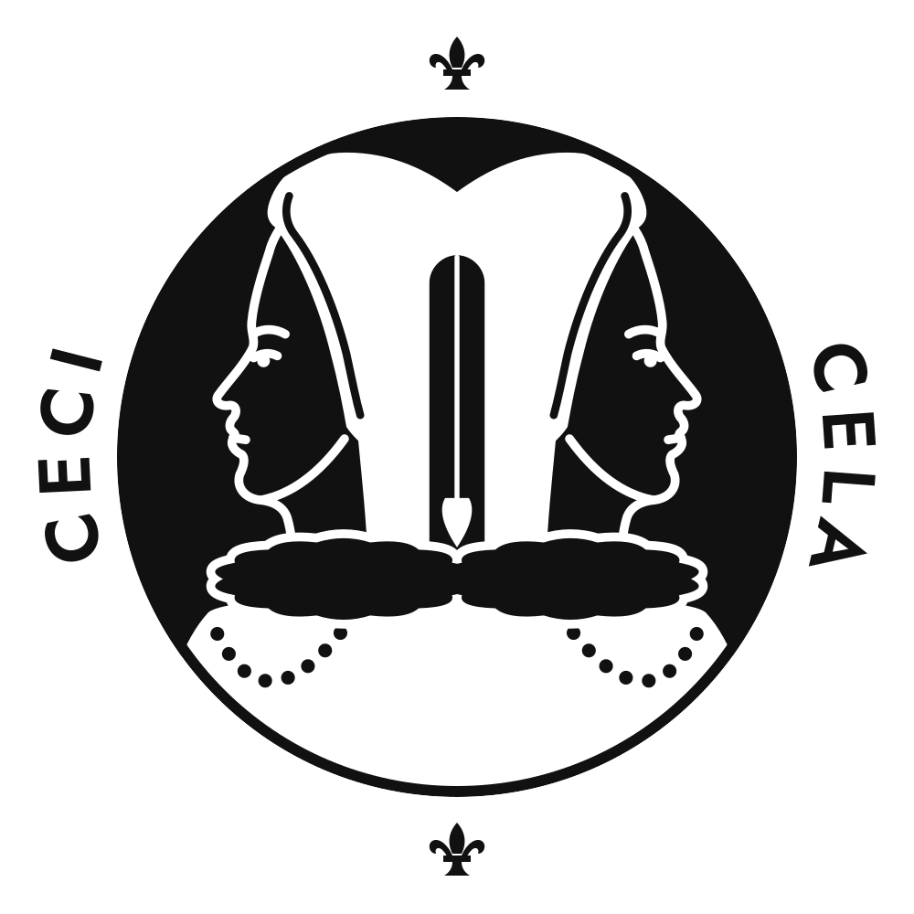

# Brand

The ceciCela mark is a one-colour seal: two young women in profile, back to back under one French hood, a plumb line hanging between them, ringed by CECI and CELA with fleurs-de-lis. This, that, and the measure that decides between them.

 

It was drawn in a Claude design canvas ("Ceci · Cela Seal", page 2) and exported here as plain SVG: the lettering is outlined, so no file needs a font. Ink is `#111111`, paper `#ffffff`. Provenance: [PROVENANCE.md](PROVENANCE.md).

## Files

| File | Use |
| --- | --- |
| `seal.svg`, `seal-dark.svg` | The mark: dark on light, and reversed (light on dark). README header, docs, anywhere the full seal fits. |
| `bust.svg`, `bust-dark.svg` | The figure without the ring, inside its disc. GitHub avatar and small icons, where the ring would turn to a blur. |
| `outline-32.svg` | The figure alone, white on transparent: the 32 px outline icon (Microsoft 365). Paper areas are holes. |
| `seal-outline.svg` | The full seal, white on transparent, for larger single-colour uses (a sticker, an engraving). |
| `png/seal-1024.png`, `-512`, `-300`, `-216` | The seal on transparent. 300 and 216 are the Microsoft marketplace logo sizes. |
| `png/seal-dark-1024.png` | The reversed seal. |
| `png/seal-192.png` | The seal with 10% padding: the Microsoft 365 colour icon (`chat/m365/appPackage/color.png`). |
| `png/bust-64.png` | The 64 px icon (the GPT Store profile image reads at this size). |
| `png/outline-32.png` | The 32 px outline icon (`chat/m365/appPackage/outline.png`). |
| `png/avatar-1024.png` | The GitHub organization avatar: the figure on a white square. |
| `png/social-1280x640.png` | The GitHub social preview. Its source is `source/social-banner.html`, which loads Jost from Cloudflare's cdnjs. |
| `portrait/` | The alternate seal from the same canvas (page 1): one woman in a French hood, ruff and pearls, ringed by CECI · CELA and RIEN SANS PREUVE. Same file set. Not the mark; kept for reference. |

At 32 px the full seal is mostly ring, so the small sizes use the figure without it: the double hood, the plumb line, and the two ruffs still read.

## Where it is used

- `README.md` header: `seal.svg`.
- Microsoft 365 agent icons: `npm run chat:build` copies `png/seal-192.png` and `png/outline-32.png` into `chat/m365/appPackage/`.
- By hand: the GitHub org avatar (`png/avatar-1024.png`) and the repository's social preview (`png/social-1280x640.png`, Settings, General, Social preview).

## Fonts

The lettering is Jost SemiBold. Every font this repository loads comes from Cloudflare's cdnjs, never Google Fonts; a test fails on a Google Fonts URL or on any stylesheet link that is not a pinned cdnjs fontsource package. The SVGs carry the letters as paths, so they load no font at all.

| Font | cdnjs package | Loaded by |
| --- | --- | --- |
| Jost 500, 600 | [fontsource-jost 5.3.0](https://cdnjs.com/libraries/fontsource-jost) | `source/social-banner.html` |
| JetBrains Mono 400, 700 | [fontsource-jetbrains-mono 5.3.0](https://cdnjs.com/libraries/fontsource-jetbrains-mono) | the chat graph player (`chat/src/graph-player.html`), with the system monospace as fallback where a chat host blocks outside stylesheets |

## Changing the mark

Edit it in the canvas, then re-export: outline the lettering from Jost 600 (cdnjs), convert the canvas's CSS classes to SVG attributes, and render the PNGs at the sizes above with a headless browser. Record the change in [PROVENANCE.md](PROVENANCE.md).
