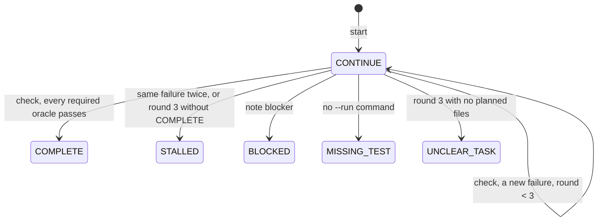

# cela 1.0.0

cela makes "done" something a tool measures, not something you claim. You plan the change, `scripts/cela.js` runs the checks, and its verdict names the result. Follow this for the current task only.

## The tool

`scripts/cela.js` sits next to this file. Run it with `node` from the repository root, for example `node ${HERMES_SKILL_DIR}/scripts/cela.js gate`. Below, `T` stands for that command. If `cela` is on PATH, `cela <command>` is the same.

## The loop

1. **Look first.** Run `git status`. Read the code you will change and the tests that cover it. Never invent paths, APIs, versions, flags, or commands.
2. **Start.** Choose the risk: LOW (local, easy to revert), MODERATE (shared code or a behavior change), HIGH (persistence, security, public API, concurrency), CRITICAL (money, auth, destructive operations, migrations). Split the request into requirements, one `--req` per testable clause, including the ones that are easy to skip: errors, empty input, boundaries.

   ```
   T start --risk LOW --task "<the request in one line>" \
     --req "empty input returns []" --req "a quoted field may contain commas" \
     --files src/a.js,test/a.test.js --run "npm test"
   ```

   - `--files`: every file you intend to change, tests included. `--run`: each command that must pass (repeat the flag); use the repository's real test command.
   - Fixing a bug: add `--repro "<command that fails now>"`, then run `T check --before` before editing source. Nothing broken: add `--no-defect`.
   - `start` prints the memory records that match the task; `T memory search <terms>` finds more. Current evidence beats memory.
   - Run `start` once per task. Mid-task, `T plan --add <files> --why "<reason>"` changes the files and `T req "<clause>"` adds a requirement.
3. **Implement** the smallest change that does the job, with a test for each requirement. runtime passes only when a changed test, or a test that imports a changed file, exists and the commands pass.
4. **Cover.** `T cover R1 test/a.test.js "<text that names the test>"` for each requirement. The file must be a test that contains the text. coverage passes only when every requirement is covered by a test that touches the change.
5. **Check.** `T check` runs the commands, scores the oracles, and prints the verdict. On CONTINUE, fix the first reason and check again. `check` refuses a fourth round; the same failure twice ends as STALLED. `T gate` reprints the verdict without running anything.
6. **Report** the terminal state exactly as printed, with its reasons. Never say COMPLETE unless `gate` printed COMPLETE.



## What the tool measures

| Oracle | Weight | Pass when |
| --- | --- | --- |
| runtime | 30 | every `--run` command exits 0, and a test changed or imports a changed file |
| repo | 20 | the diff touches exactly the planned files |
| coverage | 20 | every requirement is covered by a test that touches the change; value is covered/total |
| repro | 10 | the repro failed before the fix and passes after it |
| external | 10 | every external claim you recorded is verified (not applicable if none) |
| claims | 10 | share of recorded claims that are verified (reported, not required) |

Required: LOW and MODERATE need runtime, repo, coverage. HIGH adds repro, unless you started with `--no-defect`. CRITICAL also needs every external claim verified, so record each outside fact the change relies on. Any failing oracle blocks COMPLETE.

Scores run 0 to 10: an oracle is pass 10, partial 5, fail 0. Q is their weighted mean: 10 omega (every measured oracle passed), 8+ strong, 5+ mixed, under 5 weak, 0 alpha (nothing passed). Q informs; the gate decides. `T protocol` prints every scale.

## Claims, notes, blockers

- A fact from outside the repository (an API's behavior, a version, a flag): `T claim "<fact>" --external --source <url or path>`. Add `--verified` only after you read that source. Add `--off-path` when it does not affect the changed code.
- Decisions and assumptions: `T note decision "<text>"` or `T note assumption "<text>"`.
- If you cannot proceed without credentials, a user decision, or a missing environment, run `T note blocker "<why>"`. The gate then reports BLOCKED. Stop and say what you need.

## Depth

Default is lean: the loop above. Use full when the user asks for it, when `.cela/depth` says `full`, or when the risk is HIGH or CRITICAL. Full adds `references/discover.md` before start, and `references/audit.md` before you report. Pass `--depth full` to `start`. Read `references/git.md` only when asked to commit, push, or use a worktree.

## Memory

Store durable, reusable, verified facts, never secrets or task progress:

```
T memory add --class OBSERVED --fact "<one line>" --evidence "<file, command, or URL>"
```

Classes: USER_SPECIFIED, OBSERVED, VERIFIED_EXTERNAL, INFERRED. When a record proves wrong, run `T memory stale <id>`.

## Rules

- The tool owns `.cela/`. Do not edit those files by hand.
- An unrun test is not a pass. Do not describe results you did not see.
- Never run `git reset --hard`, `git clean -fd`, or `git push --force` without explicit permission.

## Commands the user may type

`/cela <task>` runs the loop. `/cela status` runs `T state`. `/cela audit` reads `references/audit.md`. `/cela memory <terms>` runs `T memory search`. `/cela depth full <task>` runs the loop at full depth.

`scripts/package.json` keeps `scripts/cela.js` CommonJS when an ancestor package.json sets "type": "module".
