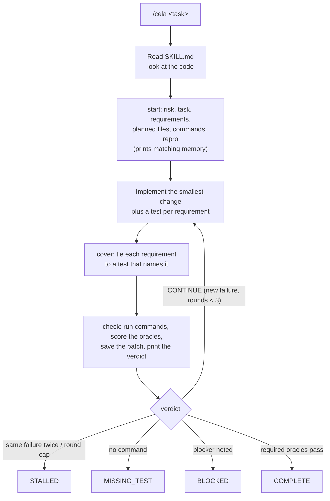

# cela: a tool names the result

[](https://github.com/actviteai/cecicela/actions/workflows/ci.yml)
[](https://www.gnu.org/licenses/gpl-3.0)
[](https://www.npmjs.com/package/@actvite/cela)

Harnesses: Cursor, OpenAI Codex, Claude Code, GitHub Copilot, Grok Build, Google Antigravity, Block Goose, Cline, and Nous Research Hermes Agent. Framework: NVIDIA NeMo Agent Toolkit. See [Install](#install).

---

## <a id="description"></a> Description

> **cela** — an evidence-first protocol and skill for AI coding agents (research-driven adaptive planning with quality gates). A bundled tool runs the checks and names the result, so the model never grades its own work.

cela is part of **[ceciCela](https://github.com/actviteai/cecicela)**: *ceci plans this, cela proves that, trouble fixes what breaks.* [`/ceci`](../ceci) calls `/cela` on every job that changes code, data, or a model, and stores the token it prints. cela also works on its own: `cela start ... · cela check · cela gate`.

This is cela **1.0.1**, the first release under this name. The engine, its oracles, the `state.jsonl` format, and the memory records carry over unchanged from the protocol's 2.1 line; only the names moved (`/cela`, `cela`, `.cela/`, `~/.cela`, `CELA_HOME`, `cela_nat`). Old project directories are left alone: a new `cela start` (or `cela init`) begins a `.cela/` beside them.

---

## <a id="overview"></a> Overview

Coding agents often say "done" when they are not. They grade their own work, and a self-grade is an opinion. cela moves that decision into code: **the model proposes, the tool decides.**

The agent reads `SKILL.md` (about 1.5k tokens), plans the change, and then drives `tool/cela.js`, a zero-dependency Node script that ships inside the skill:

| Step | Command | What the tool does |
| :--- | :--- | :--- |
| Plan | `start --risk LOW --task "<request>" --req "<clause>" --files a,b --run "npm test"` | Records what "done" means: risk, the request, its requirement clauses, planned files, required commands, optional repro. |
| Prove the bug | `check --before` | Runs the repro so the fix can be shown to change it from failing to passing. |
| Cover | `cover R1 test/a.test.js "<test name>"` | Ties each requirement to a test that exists and names it. |
| Measure and decide | `check` | Runs the commands, scores six oracles, saves the round's patch, and prints the verdict. COMPLETE only when every required oracle passes. `gate` reprints it. |

| Problem in typical agents | What cela does |
| :--- | :--- |
| "Done" with failing or missing tests | `gate` refuses COMPLETE unless the required commands ran and passed. No command at all is `MISSING_TEST`. |
| Tests pass but never touch the change | runtime only passes when a test that ran changed, or imports a changed module. |
| Tests only for what was implemented, not what was asked | Each clause of the request is a requirement; coverage passes only when every one is covered by a test that touches the change. |
| Scope creep and stray edits | repo passes only when the diff matches the planned files; changing the plan needs a logged reason. |
| Fixes that never proved the bug | HIGH and CRITICAL need a repro that failed before and passes after. |
| Endless retry loops | At most 3 rounds, and the same failure twice ends as `STALLED`. |
| Token-heavy state files | The model reads a few lines per command; the tool writes the full record (log, patch per round, timings) to disk, where it costs nothing. Memory is one record per line, searched rather than read. |

---

## <a id="system-architecture"></a> How it works

The host model is the control plane; cela runs no server. `bin/cela.js` is the only installer, and it also forwards task commands to the engine. Personal harness files are created when missing and are not replaced unless you pass `--force` (the previous file is kept as `*.cela-backup`). Skill trees are staged and renamed into place, so a failed copy cannot delete a working install.



With `init --hook`, Claude Code also gets a Stop hook: while an cela task's gate says CONTINUE, or files changed since the last check, the agent cannot end its turn.

---

## <a id="install"></a> Install

Node.js 22 or newer.

`install` writes your user files for a harness. `init` writes a project's files. `status` shows what is installed. There is no `update` command: run the same install again.

```bash
npx --yes @actvite/cecicela install --all     # ceci, cela, and trouble together
npx --yes @actvite/cela install --claude      # cela alone, one harness
npx --yes @actvite/cela install               # cela alone, all nine chat harnesses (same as --all)
npx --yes @actvite/cela install --global-only # the core only: ~/.cela
npx --yes @actvite/cela install --nemo        # NeMo Agent Toolkit: the engine, then the pip step it prints
npx --yes @actvite/cela init                  # the current project (--hook, --force, --repo <dir>)
npx --yes @actvite/cela status
npm install -g @actvite/cela && cela install --claude
```

What the flags mean:

- **Harness flags.** `--cursor`, `--codex`, `--claude`, `--copilot`, `--grok`, `--antigravity`, `--goose`, `--cline`, `--hermes`, `--nemo`. No flag, or `--all`, installs the nine chat harnesses; NeMo is a framework and is only set up when you name it. Do not pass harness flags to `init`.
- **Edited files are kept.** A harness file that differs from the packaged copy stays as it is, and the packaged copy is written beside it as `<file>.cela`. Diff that sidecar. `--force` saves yours as `<file>.cela-backup` and writes the new one. Skill trees are staged and renamed into place only after `SKILL.md` is present, so a failed update does not delete a working install.
- **Update keeps** `$CELA_HOME/memory/`, `$CELA_HOME/projects/`, and a repository's `<repo>/.cela/`. `npm install` updates the CLI package only; run `cela install` again afterward. Start a new harness session after an update so it does not keep the previous `SKILL.md` in context.
- **`--global-only`** writes `$CELA_HOME` (default `~/.cela`): `skills/cela/`, plus empty `memory/`, `projects/`, and `registry/`.
- **Homes.** `CELA_HOME`, `CURSOR_HOME`, `CLAUDE_HOME`, `COPILOT_HOME`, `GROK_HOME`, `GEMINI_HOME`, `CLINE_HOME`, `AGENTS_HOME`, and `HERMES_HOME` redirect the directories below without touching the real user profile. Hermes on Windows defaults to `%LOCALAPPDATA%\hermes`, as Hermes itself does.

### <a id="harnesses"></a> What each harness gets

The harness table is shared with ceci and trouble (it lives in the repository's `packages/core`). A harness slash command is `/cela` when the client loads `SKILL.md`, and `/cela` also works where a project bridge or the Claude command file is present.

| Harness | User install | What it writes | Project install (`init`) | Invoke |
| :--- | :--- | :--- | :--- | :--- |
| **Cursor** | `--cursor` | `~/.cursor/skills/cela/` | `AGENTS.md`, `.agents/skills/cela/` | `/cela` |
| **Codex** | `--codex` | `~/.agents/skills/cela/` | `AGENTS.md`, `.agents/skills/cela/` | `/cela` |
| **Claude Code** | `--claude` | `~/.claude/skills/cela/`, `~/.claude/commands/cela.md` | `CLAUDE.md`, `.claude/skills/cela/`, `.claude/commands/cela.md` | `/cela` |
| **Copilot** | `--copilot` | `~/.copilot/skills/cela/` | `.github/copilot-instructions.md`, `.agents/skills/cela/` | `/cela` where skills load; project instructions are always on after `init` |
| **Grok Build** | `--grok` | `~/.grok/skills/cela/` | `.grok/rules.md` | `/cela` |
| **Antigravity** | `--antigravity` | `~/.gemini/antigravity-cli/skills/cela/`, `~/.gemini/config/skills/cela/` | `GEMINI.md`, `AGENTS.md`, `.agents/skills/cela/` | `/cela` |
| **Goose** | `--goose` | `~/.agents/skills/cela/` (the folder Codex uses) | `.goosehints`, `.agents/skills/cela/` | `/skills cela` in the CLI, or ask for cela by name |
| **Cline** | `--cline` | `~/.cline/skills/cela/` | `.clinerules/cela.md`, `.claude/skills/cela/` | `/cela`; skills are on by default |
| **Hermes Agent** | `--hermes` | `~/.hermes/skills/software-development/cela/` | none; see below | `/cela`, or when the request matches the skill's description |
| **NeMo Agent Toolkit** (framework) | `--nemo` | the engine under `~/.cela/`; prints the `pip install` step, never runs it | none | `cela__*` tools in a workflow YAML; needs Node 22 on the host |

`init` writes every bridge in the table plus `.claude/commands/cela.md`, and the skill trees `.agents/skills/cela/` (Cursor, Codex, Copilot, Antigravity, Goose) and `.claude/skills/cela/` (Claude Code, Cline). Every bridge is [`bridges/project.md`](bridges/project.md); the Claude command is [`bridges/claude/commands/cela.md`](bridges/claude/commands/cela.md). User installs never add always-on global rules for harnesses that load skills on demand, so cela stays out of sessions that do not invoke it. The one global bridge, the Claude command, points at the installed core under `$CELA_HOME`.

**Plugin marketplace.** The ceciCela repository is a marketplace: `/plugin marketplace add actviteai/cecicela`, then `/plugin install cela@cecicela` (or the whole bundle, `cecicela@cecicela`).

**Hermes Agent.** Hermes skills are user-wide, so `--hermes` writes only the skill tree, with a Hermes frontmatter (`description` that opens with the trigger sentence, `platforms`, `metadata.hermes.tags`, and `requires_toolsets: [terminal]` because the engine runs through the terminal tool). The body names the engine as `${HERMES_SKILL_DIR}/tool/cela.js`, which Hermes expands to the installed path. Hermes can also install the skill straight from the repository, without Node.js for the installer (the engine still needs Node 22 to run):

```bash
hermes skills install https://raw.githubusercontent.com/actviteai/cecicela/main/bundle/hermes/cela/SKILL.md --category software-development
```

That copy is `bundle/hermes/cela/`: the same SKILL.md body with the engine at `scripts/cela.js` and the playbooks under `references/`, because a URL install copies only files SKILL.md names under those directories. It is generated by the repository's `npm run sync`, and `npm test` fails if it drifts.

### <a id="nvidia-nemo-agent-toolkit-framework-integration"></a> NeMo Agent Toolkit

NeMo Agent Toolkit (`nvidia-nat`, CLI `nat`) is a Python framework, not a chat harness: agents are YAML workflows that call Python tools. cela ships for it as `cela-nat`, a pip package in [`nemo/`](nemo/) that registers the engine's commands as one tool group (`cela__start`, `__plan`, `__req`, `__cover`, `__check`, `__gate`, `__claim`, `__note`, `__state`). The tools run the same `cela.js`, so the verdict still comes from the engine, not the model.

```bash
npx --yes @actvite/cela install --nemo                  # installs the engine under ~/.cela and prints the steps below
git clone https://github.com/actviteai/cecicela.git
pip install "./cecicela/packages/cela/nemo[agents]"     # into the environment that runs `nat`
nat run --config_file cecicela/packages/cela/nemo/examples/workflow.yaml --input "<task>"
```

The host needs Node.js 22 or newer, Python 3.11 to 3.13, and NeMo Agent Toolkit 1.8 or newer. `install --nemo` never runs pip, because pip-installing into an environment you did not choose breaks PEP 668 systems. cela only measures: a NeMo agent also needs tools that read and edit files and run commands, from your own workflow. `cela-nat` is not on PyPI; install it from a clone. See [`nemo/README.md`](nemo/README.md) for the tools and settings, and [`nemo/NOTES.md`](nemo/NOTES.md) for the toolkit API it relies on.

---

## <a id="canonical-commands"></a> Commands

In the agent:

| Command | Meaning |
| :--- | :--- |
| `/cela <task>` | Run the task with cela: start, implement, cover, check. |
| `/cela depth full <task>` | Also run discovery before `start` and the audit checklist before reporting. |
| `/cela status` | Risk, planned files, last check, and the current gate verdict. |
| `/cela audit` | Adversarial audit checklist, then check and gate again. |
| `/cela memory <terms>` | Search durable memory (at most 12 records). |

The engine, run by the agent or by you (`node .agents/skills/cela/tool/cela.js <command>`, or `cela <command>` after `npm install -g @actvite/cela`):

| Command | Meaning |
| :--- | :--- |
| `start --risk R --task "<request>" --req "<clause>" [--req ...] --files a,b --run "<cmd>" [--repro "<cmd>" \| --no-defect] [--depth full] [--keep]` | Define done for a new task (`--keep`: redefine the current one). Prints the memory records that match it. |
| `plan --add a --drop b --why "<reason>"` | Change the planned files, with a logged reason. |
| `req "<clause>"` | Add a requirement mid-task. |
| `cover <R-id> <test-file> "<text>"` | Tie a requirement to a test: the file must be a test that contains the text. |
| `check [--before]` | Run the oracles, save the round's patch, and print the verdict (`--before`: run the repro before fixing). |
| `gate [--json]` | Reprint the terminal state without running anything. Exit code 0 COMPLETE, 3 CONTINUE, 1 otherwise. |
| `claim "<fact>" [--external] [--source s] [--verified] [--off-path]` | Record a claim for the external and claims oracles. |
| `note decision\|assumption\|risk\|question\|blocker "<text>"` | Log a note. A blocker makes the gate report BLOCKED. |
| `state [--json]` | Task summary. `--json` prints one JSON object (`spec`, `required`, `rounds`, `lastCheck`, `notes`, `gate`, `outcome`) and writes nothing. |
| `outcome accepted\|revised\|rejected [--why "<text>"] [--task <id>]` | What happened to the work after the gate, set by the reviewer or CI, never by the agent: accepted (shipped as the gate measured it), revised (shipped after changes the gate did not ask for), rejected (discarded). `--task` labels an archived task by id. |
| `memory add\|search\|stale\|stats\|compact` | Durable memory. |
| `export --out <file> [--repo <dir>]...` | Append one anonymized row per task, current and archived (no text, paths, or code), with the gate's verdict and the reviewer's outcome side by side. |
| `protocol [--json]` | The risks, required oracles, weights, and what every score means. |
| `hook-stop` | Claude Code Stop hook. |

---

## <a id="oracles"></a> Oracles and gates

`check` computes six oracles. Each is `pass` (10), `partial` (5), `fail` (0), or not applicable:

| Oracle | Weight | Pass | Partial |
| :--- | :---: | :--- | :--- |
| runtime | 30 | Every `--run` command exits 0, and a test changed or imports a changed file by path. | Commands pass, but no test touches the change. |
| repo | 20 | The diff touches exactly the planned files. | Extra files are only lockfiles or build output. |
| coverage | 20 | Every requirement (`--req`, `req`) is covered by a test that exists, contains the cover's text, and changed or imports a changed file. Its value is covered/total on the 0–10 scale. | Some requirements are covered. |
| repro | 10 | The repro failed before the fix (run before any source edit) and passes after it. | It passes now, but was not run before the source changed. |
| external | 10 | Every recorded external claim is verified. | Unverified claims are all marked off the changed path. |
| claims | 10 | Share of recorded claims that are verified, 0–10. | — |

Q is the weighted mean of the oracles that ran. Its scale has a named floor and ceiling, so a number is never read without its meaning: **10 omega** (every measured oracle passed), **8+ strong** (light evidence missing), **5+ mixed** (a failing oracle, or several partial ones), **under 5 weak** (the main oracles failed), **0 alpha** (no measured oracle passed). `cela protocol` prints every scale. Q informs; the gate decides:

| Risk | Required to pass |
| :--- | :--- |
| LOW, MODERATE | runtime, repo, coverage |
| HIGH | runtime, repo, coverage, repro (or `--no-defect`) |
| CRITICAL | runtime, repo, coverage, repro, and every recorded external claim verified |

Any oracle at `fail` blocks COMPLETE. A check is tied to the plan it ran against: editing files, changing the plan, or adding a requirement afterwards means checking again. `check` refuses a fourth round. Terminal states are `COMPLETE`, `STALLED` (same failure twice, or 3 rounds used), `BLOCKED` (a blocker note), `MISSING_TEST` (no required command), and `UNCLEAR_TASK` (not started, or no planned files by the round cap). A new `start` moves the previous task's files to `.cela/archive/<time>/`. `CONTINUE` means fix the first reason and check again. A task is COMPLETE only when the tool prints it, and the agent reports the verdict and its reasons exactly as printed.

Coverage is the one oracle that looks at the request rather than the code. In the eval behind this release, every false COMPLETE came from a spec clause the agent never wrote a test for; the engine measured the tests that existed correctly. Listing each clause as a requirement and covering it is a gauntlet the tool can enforce: the agent names the test, the tool checks that it exists, names it, and touches the change.

---

## <a id="storage-and-persistence-model"></a> Task log and memory

```
<repo>/.cela/
├── oracles.json     # what "done" means: id, risk, task, requirements, files, commands, repro (start, plan, req)
├── state.jsonl      # append-only: start, plan, req, cover, check, gate, claim, note, stop, outcome
├── rounds/<n>.patch # the exact diff each check round measured
├── archive/<time>/  # the previous task (oracles.json, state.jsonl, rounds/), moved whole by the next start
└── depth            # optional: "full" to default this repo to full depth

$CELA_HOME/ (default ~/.cela)
├── skills/cela/   # installed skill and tool
├── memory/records.jsonl              # global memory, one record per line
└── projects/<id>/records.jsonl       # per-project memory
```

The agent never reads or rewrites task files; the tool appends to them. That split is what keeps the protocol cheap: the model sees a few lines per command, while the record on disk holds the task statement, each requirement and its cover, every command's exit code and duration, the diff statistics and full patch of every round, each verdict, every stop the Claude Code hook refused, and the outcome the reviewer set afterwards. The verdict is the gate's prediction and the outcome is the truth, which is what a training set needs; the agent never sets the outcome, and `SKILL.md` does not mention the command. `export` turns every task record, current and archived, into one anonymized row (counts, scores, verdict, outcome; never text, paths, or code). Memory records are one line each, with provenance (`class`, `evidence`, `verified` date) and status (`ACTIVE`, `STALE`, `SUPERSEDED`, `INVALID`). The tool enforces the rules instead of asking the model to: facts up to 240 characters, evidence up to 160, at most 80 active global and 40 active project records, no duplicates, and nothing that looks like a secret. `memory search` returns at most 12 matching records, so memory never loads in bulk. `memory compact` moves retired records to `archive/YYYY-MM.jsonl`.

---

## <a id="eval"></a> Eval

`eval/` measures whether cela helps instead of asserting it. Eight small Node tasks (bug fixes, features, a refactor, and two traps whose visible tests pass on a naive fix) each ship hidden tests and a reference solution. `node eval/run.js --self-test` proves the hidden tests fail on the starting code and pass on the reference; `npm test` runs it.

```bash
node eval/run.js --agents claude:claude-sonnet-5-5,claude:claude-haiku-4-5-20251001 --conditions none,lean,full --reps 2 --out eval/results/1.0.1
node eval/report.js eval/results/1.0.1 --write
```

The headline number is the **false-DONE rate**: runs that ended with "STATUS: DONE" while the hidden tests fail. Agents run with a scoped tool allowlist (read, edit, `node`, `npm test`, `git`) and project settings only.

The eval drives live models, so it is not part of CI. The 1.0.0 baseline belongs in `eval/results/1.0.0/`; it is accepted when its per-task pass/fail set matches the archived 2.1.0 baseline of the protocol's previous name (scores vary run to run; the pass set must not). Results from that earlier line stay with the archived repository. <!-- keep-version -->

---

## <a id="directory-structure"></a> Directory Structure

```text
packages/cela/
├── bin/cela.js                   # CLI: install, init, status, and task commands
├── lib/installer.js              # install, init, status (on the shared core)
├── lib/skill.js                  # install for @actvite/cecicela
├── lib/hermes.js                 # Hermes Agent frontmatter render and checks
├── lib/check-static.js           # static checks npm test runs first
├── lib/core/                     # generated copy of packages/core (the harness table and file primitives)
├── bridges/                      # project.md (every init bridge) and claude/commands/cela.md
├── nemo/                         # cela-nat: NeMo Agent Toolkit tools (pip package, optional pytest job)
├── eval/                         # hidden-test eval harness
├── test/                         # node:test suites
└── skill/                        # the skill that gets installed
    ├── SKILL.md                  # the protocol (loaded on every /cela run)
    ├── tool/cela.js              # the engine: start, req, cover, check, gate, memory, export, protocol, hook
    ├── playbooks/                # discover.md and audit.md (full depth), git.md
    └── install/                  # skill-local installers
```

---

## <a id="faq"></a> Frequently Asked Questions (FAQ)

<details>
<summary><strong>How does cela differ from a system prompt that says "run the tests"?</strong></summary>
A prompt asks the model to check itself and trusts what it reports. cela hands the checking to a script: the model cannot mark a task COMPLETE, only the <code>gate</code> command can, and it reads results the script recorded, not the model's summary.
</details>

<details>
<summary><strong>Can I use cela in CI?</strong></summary>
Yes. <code>cela gate</code> exits 0 only on COMPLETE, and <code>.cela/state.jsonl</code> is plain JSON lines, so a CI job can re-run <code>cela check && cela gate</code> on the agent's branch, and <code>.cela/rounds/</code> holds the patch each round measured.
</details>

<details>
<summary><strong>Does cela slow down small tasks?</strong></summary>
Lean depth, the default, is one plan command, the edit, one check, and one gate. The eval section reports the measured token and time cost against no protocol.
</details>

<details>
<summary><strong>How do I override the default storage directory?</strong></summary>
Set the <code>CELA_HOME</code> environment variable:
<pre><code>export CELA_HOME=/custom/path/.cela</code></pre>
Per-harness homes use <code>AGENTS_HOME</code> (Codex), <code>CURSOR_HOME</code>, <code>GROK_HOME</code>, <code>COPILOT_HOME</code>, <code>CLAUDE_HOME</code>, <code>CLINE_HOME</code>, <code>GEMINI_HOME</code>, and <code>HERMES_HOME</code>.
</details>

---

## <a id="license"></a> License

This project is licensed under the **GNU General Public License v3.0** (GPL-3.0-or-later). See [LICENSE](LICENSE) for full details.

---

## <a id="contributing"></a> Contributing

cela is developed in the [ceciCela monorepo](https://github.com/actviteai/cecicela). Run `npm test` at the repository root (Node.js 22+): it checks the installer, the engine, the eval tasks, the npm tarball, version consistency, and the rules for text the model reads: prose for rules, tables for shaped facts, Mermaid only for relationships, numbers rendered from the engine, JSON only for programs. Protocol changes should also come with an eval run. After changing anything in `skill/`, run `npm run sync` at the root so the generated copies match. Never edit version stamps by hand; `npm run stamp` repairs drift. A line that must name another version ends with `<!-- keep-version -->`. CI holds no npm token and never publishes; see the root README's Releasing section.

**Issues:** [https://github.com/actviteai/cecicela/issues](https://github.com/actviteai/cecicela/issues)
